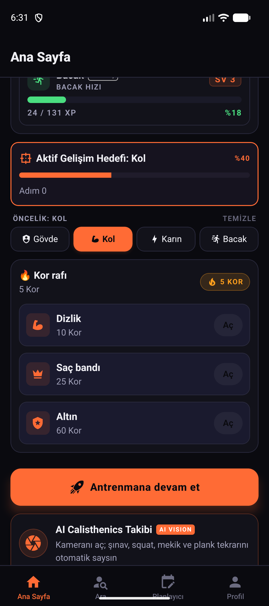
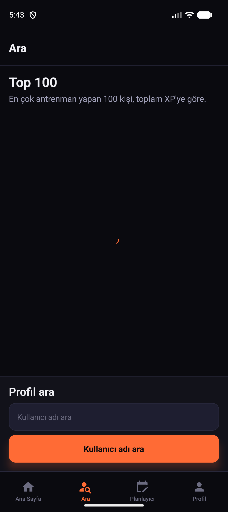
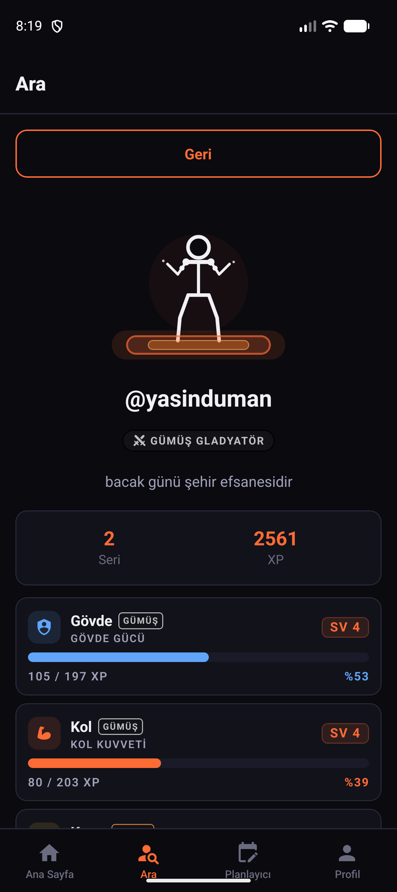
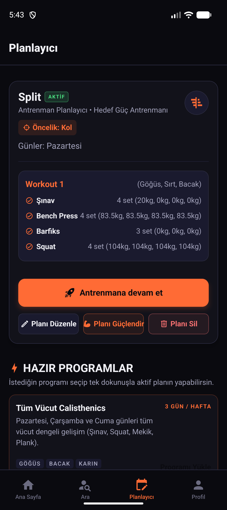
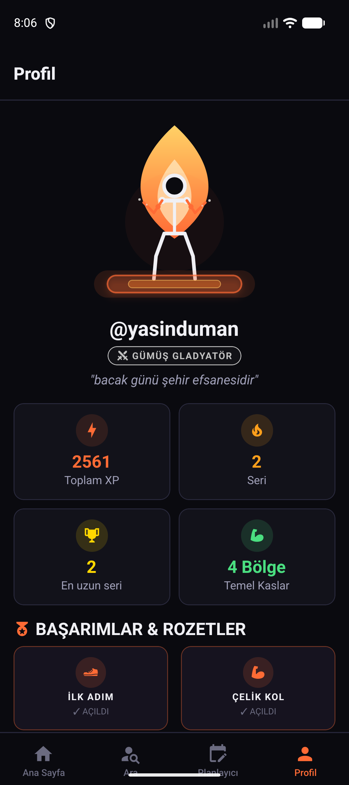
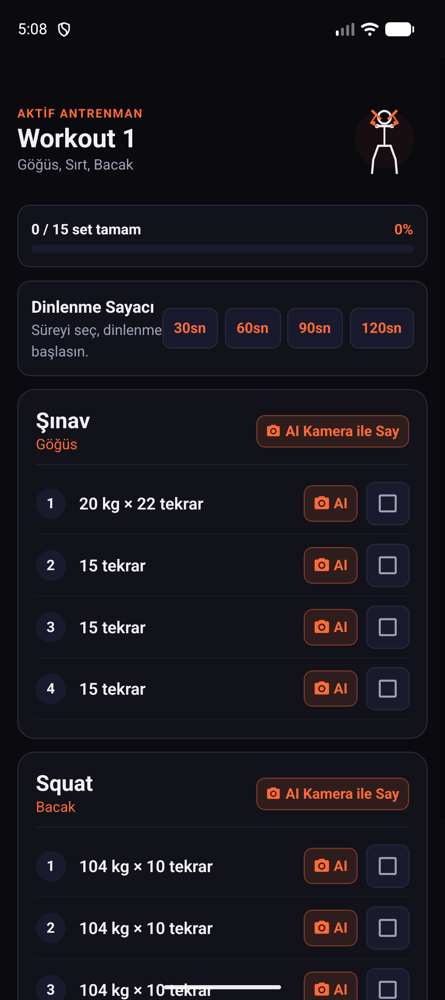

# Stickman Tycoon Workout

<p align="center">
  
</p>

<p align="center">
  <b>Antrenman motivasyonu veren, Roblox Tycoon bağlayıcılığında seviye ve prestij kademeleriyle evrimleşen çöp adam (stickman) mobil fitness uygulaması.</b>
</p>

<p align="center">
  <a href="https://reactnative.dev/"></a>
  <a href="https://www.typescriptlang.org/"></a>
  <a href="https://github.com/ysinduman/StickmanWorkout"></a>
  <a href="https://github.com/ysinduman/StickmanWorkout"></a>
  <a href="https://github.com/ysinduman/StickmanWorkout"></a>
  <a href="https://supabase.com/"></a>
  <a href="https://github.com/ysinduman/StickmanWorkout"></a>
</p>

---

## 📱 Uygulama Ekran Görüntüleri

<p align="center">
  
  
  
</p>
<p align="center">
  
  
  
</p>

---

## 🌟 Öne Çıkan Özellikler

| Özellik | Açıklama |
| :--- | :--- |
| 🏰 **Roblox Tycoon Bağlayıcılığı** | Işıklı podyum, dinamik alev aurası, seviye kademe etiketleri (Bronz, Gümüş, Altın, Titan, Efsane), Kor dükkanı kilitleri ve 2X Odak çarpanları. |
| 🤖 **AI Kamera Takibi (Computer Vision)** | Ön kamera üzerinden tamamen cihazda yerel çalışan gerçek zamanlı eklem analizi (Şınav, Squat, Mekik, Plank). |
| ⚡ **4 Temel Kas Bölgesi (1–100 Vektörel Motor)** | Yalnızca 4 temel bölge: **Gövde**, **Kol**, **Karın** ve **Bacak** odaklı dinamik prosedürel SVG motoru. |
| 📳 **Haptik Dokunsal Geri Bildirim** | Tamamlanan her sette fiziksel tıklama titreşimi, seviye atlamalarında arcade çoklu rumble efekti. |
| 🛡️ **Play Store & Gizlilik Uyumlu** | Kamera görüntüleri asla sunucuya aktarılmaz; açılır Gizlilik & Güvenlik Politikası ve ProGuard kuralları entegredir. |
| 🏆 **Top 100 Liderlik & Vitrin Rozetleri** | Altın taçlı liderlik sıralaması, 2x2 vitrin rozetleri ve dinamik prestij unvanları (Gladyatör, Şampiyon, Titan). |

---

## 🚀 4 Temel Kas Bölgesi ve 1–100 Evrim Motoru

Uygulama, karmaşık ve gereksiz vücut bölgeleri yerine en temel 4 ana bölgeye odaklanır:

### 4 Temel Kas Bölgesi:
1. **Gövde (Torso):** Göğüs, sırt kanatları (V-Taper) ve omuz gülleleri (cannonball deltoids).
2. **Kol (Arms):** Pazu (biceps), triceps ve ön kol kütlesi.
3. **Karın (Abs):** Derin kesimli six-pack tuğlaları ve core hattı.
4. **Bacak (Legs):** Dış bacak kavisi (quad sweep) ve kalf formu.

### Evrim Evreleri:
* **Seviye 1 – 50 (Hipertrofi):** Temel cılız çöp adamdan devasa kas kütlesine doğru lineer/sub-kuadratik büyüme (`growth: 0.0 → 1.0`).
* **Seviye 51 – 99 (Damarlanma - Vascularity):** Hacim korunurken her seviyede dallanan vasküler damar hatları kalınlaşır (`vascularity: 0.02 → 1.0`).
* **Seviye 100+ (Prestij Auraları):** 100-199 Altın (`#FFD700`), 200-299 Elmas Mavi (`#00F0FF`), 300+ Efsanevi Kozmik Mor (`#BD00FF`).

---

## 🤖 Yapay Zeka (AI) Kamera Egzersiz Takibi

Kamera üzerinden gerçek zamanlı bilgisayarlı görü (computer vision) ile vücut eklem açılarını analiz eder:

* **Şınav (Push-up):** Dirsek açısı (Omuz - Dirsek - Bilek) ve gövde açısı analizi ile tam iniş/kalkış sayımı.
* **Squat:** Diz açısı (Kalça - Diz - Ayak Bileği) derinliği doğrulaması.
* **Mekik (Crunches):** Gövde fleksiyon açısı (Omuz - Kalça - Diz) algılama.
* **Plank:** Düz omurga hattı (Omuz - Kalça - Ayak Bileği) hizalaması ve canlı süre sayacı.
* **Akıllı Form Düzeltme:** Yanlış açılarda sesli ve görsel ikazlar verir.

### Hazır Calisthenics Programları
1. **Full Body Beginner (Tüm Vücut Başlangıç):** Temel vücut ağırlığı hareketleri ve kondisyon altyapısı.
2. **Upper Body Beast (Üst Vücut Canavarı):** Şınav varyasyonları, omuz ve karın odaklı hacim antrenmanı.
3. **Core & Legs Shred (Karın & Bacak Parçalayıcı):** Squat, crunches ve plank kombinasyonu ile yüksek yoğunluklu dayanıklılık.

---

## 🛠️ Mimari ve Teknolojiler

* **Mobil Çatı:** Bare React Native 0.87.1, React 19.2.3 (Hermes, New Architecture)
* **Vektörel Çizim:** `react-native-svg` (prosedürel koordinat hesaplamaları)
* **Durum Yönetimi:** `zustand` + `@react-native-async-storage/async-storage`
* **Navigasyon:** `@react-navigation/native-stack` + `@react-navigation/bottom-tabs`
* **Dil Desteği:** `i18next` (Türkçe & İngilizce)
* **Backend:** Supabase (PostgreSQL, Row Level Security, Security Definer RPC'ler)

---

## 📂 Proje Yapısı ve Geliştirici Araçları

```
StickmanWorkout/
├── src/
│   ├── components/
│   │   ├── Stickman/       # Dinamik SVG çöp adam ve 1-100 kas evrim motoru
│   │   ├── Calendar/       # Antrenman geçmişi takvimi ve alev efektleri
│   │   └── LevelBars.tsx   # 4 temel bölge seviye çubukları
│   ├── screens/            # Home, Search, Planner, Profile, ActiveWorkout
│   ├── stores/             # Zustand state store'ları (session, workout, priority, ember)
│   └── utils/              # AI kamera motoru, streak ve ses yardımcıları
├── scripts/
│   ├── verify-evolution.js # 4 temel bölge için 420 durum doğrulama betiği
│   ├── verify-playstore.js # 20 maddelik Play Store pre-flight denetim betiği
│   └── generate-icons.ps1  # Android ikon oluşturucu
├── gelistirici_detaylari/
│   └── stickman_evolution_preview.html # Canlı SVG evrim motoru önizleme paneli
└── Baslat_Stickman.bat     # Tek tıkla emülatör ve Metro başlatıcı
```

---

## 🚀 Hızlı Başlatma

Projeyi tek tıkla emülatör ve Metro sunucusuyla başlatmak için kök dizindeki başlatıcıyı çalıştırabilirsiniz:
```cmd
Baslat_Stickman.bat
```

Veya manuel olarak:
```bash
# 1. Metro paketleyicisini başlatın
npm start

# 2. Android uygulamasını derleyip çalıştırın
npm run android
```

---

## 🧪 Doğrulama ve Test

```bash
# Evrim motoru testlerini çalıştır (420 durum testi)
npm run test:evolution

# Google Play Store release uyumluluk denetimi (20 kontrol)
npm run test:playstore

# TypeScript tür kontrolü
npm run typecheck

# Kod kalitesi kontrolü (Linter)
npm run lint
```
